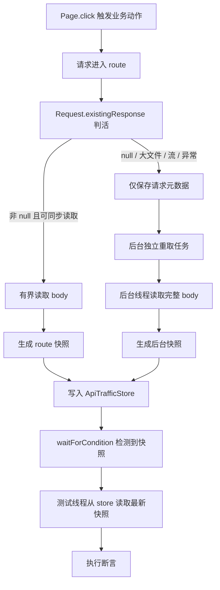

# Playwright Java 全量 API 监控方案：Route 采集 + waitForCondition 断言

## 执行摘要

**可以结合 `Page.waitForCondition` 使用，但它只能用于轮询快照是否出现，不能用来等待后台采集线程完成。**

推荐职责边界是：

1. **route 线程**负责匹配请求、读取请求元数据、有界读取 body 并立即放行；
2. **后台线程**负责大文件、流、未关联响应和完整 body 的独立重取；
3. **`ApiTrafficStore`** 保存不可变快照，作为采集侧与断言侧的唯一交接点；
4. **`Page.waitForCondition`** 周期性检查快照缓存，不参与 body 读取和请求放行；
5. **业务断言**优先使用 route 同步快照；
6. **后台快照**只用于完整 body 审计，不能冒充浏览器实际接收的业务响应。

方案基于 **Playwright Java 1.59+**。后台请求隔离、`existingResponse()` 的底层协议行为及监听器清理 API，仍需在最终锁定的小版本上复核。

---

## 一、核心设计原则

## 1.1 一句话原则

> **Route 负责放行请求，后台线程负责完整采集，waitForCondition 只负责观察快照，断言永远发生在快照出现之后。**

## 1.2 四个禁止

不得在 `BrowserContext.route` 处理程序中执行：

- `Thread.sleep()`；
- `CompletableFuture.get()`；
- 数据库访问；
- 外部 HTTP 请求；
- 大文件或流式响应的完整读取；
- `Page.waitForResponse()`；
- `Response.finished()`；
- 后台采集结果的同步等待。

不得在 `waitForCondition` 的 lambda 中执行：

- `Response.body()`；
- 后台采集；
- 数据库写入；
- 深度 JSON 解析；
- 会抛出业务断言异常的非超时逻辑；
- 直接持有或修改 `Request` / `Response` / `Route`。

## 1.3 四个允许

以下操作适合在 route 线程快速执行：

- `route.request().url()`；
- `route.request().method()`；
- `route.request().headers()` 白名单读取；
- `route.request().postData()`；
- `route.request().redirectedFrom()`；
- `Request.existingResponse()`；
- 小 body 的 `Response.body()`；
- 不可变快照构造；
- 快照投递；
- 一次 `resume()` / `fulfill()` / `abort()`。

这些操作“不会明显影响主线程”的前提是：数据量小、执行快、无外部 I/O、不重入 Playwright 控制面。

---

## 二、`waitForCondition` 的正确位置

## 2.1 它是快照轮询器，不是线程同步器

`Page.waitForCondition` 的语义是周期性检查 `Callable<Boolean>`：

- 条件返回 `true`，立即通过；
- 条件持续返回 `false`，继续轮询；
- 达到超时时间，抛出超时异常；
- 不接收后台任务句柄；
- 不能保证后台线程一定执行完毕；
- 不能把后台线程的异常直接传播到测试线程；
- 不适合直接承载完整业务断言。

因此，正确用法是：

```text
采集完成 → 写入不可变快照 → waitForCondition 发现快照 → 测试线程断言
```

而不是：

```text
采集完成 → Future.get 等待后台任务 → 断言
```

## 2.2 与采集链路的位置关系



`waitForCondition` 不控制 D、G、I，只观察 H。

---

## 三、快照存储：采集侧与断言侧的唯一交接点

## 3.1 为什么必须引入 store

后台采集任务不能直接把结果返回给 route handler，也不能把 `Response` 交给测试线程。测试线程也不能直接等待后台任务。三者必须通过不可变数据解耦。

`ApiTrafficStore` 的职责：

- 接收采集侧生产的快照；
- 按稳定 key 分组；
- 支持并发追加；
- 支持快速条件检查；
- 不持有 Playwright 对象；
- 不阻塞生产者；
- 向测试线程提供只读视图。

## 3.2 存储结构

```java
import java.util.List;
import java.util.Map;
import java.util.concurrent.ConcurrentHashMap;
import java.util.concurrent.CopyOnWriteArrayList;

public final class ApiTrafficStore {

    private final Map<String, List<ApiTrafficSnapshot>> snapshots =
            new ConcurrentHashMap<>();

    public void append(ApiTrafficSnapshot snapshot) {
        snapshots.computeIfAbsent(snapshot.stableKey(), k -> new CopyOnWriteArrayList<>())
                .add(snapshot);
    }

    public List<ApiTrafficSnapshot> findByStableKey(String stableKey) {
        return snapshots.getOrDefault(stableKey, List.of());
    }

    public boolean hasCaptured(String stableKey) {
        return !findByStableKey(stableKey).isEmpty();
    }

    public Iterable<String> keysByScenario(String scenarioId) {
        return snapshots.keySet();
    }

    public void clear() {
        snapshots.clear();
    }
}
```

## 3.3 稳定 key

推荐结构：

```text
scenarioId + "|" + startingRequestId
```

发生重定向、重试或后台重取时增加 `sequence`：

```text
scenarioId + "|" + startingRequestId + "|" + sequence
```

不要用 URL 作为唯一 key。同一 URL 可能：

- 并发请求；
- 连续调用；
- 发生重定向；
- 触发后台重取；
- 产生多个快照。

---

## 四、快照模型

## 4.1 一次请求可能对应多个快照

全量流量允许后台独立重取，因此一次请求可能产生：

1. 响应尚未关联时的元数据快照；
2. route 同步快照；
3. 后台完整重取快照；
4. 最终聚合快照。

快照必须记录采集阶段：

```java
public enum CaptureStage {
    /** route 内读取已关联响应 */
    ROUTE_SYNC,

    /** 后台对请求独立重放 */
    BACKGROUND_FETCH,

    /** 响应尚未关联时的预建快照 */
    PENDING_RESPONSE,

    /** 多个来源合并后的最终快照 */
    AGGREGATED
}
```

## 4.2 快照结构

```java
import java.time.Instant;
import java.util.Map;

public final class ApiTrafficSnapshot {

    private final String snapshotId;
    private final String scenarioId;
    private final String stableKey;
    private final String startingRequestId;
    private final String currentRequestId;
    private final int sequence;
    private final CaptureStage captureStage;
    private final RequestSnapshot request;
    private final ResponseSnapshot response;
    private final Instant capturedAt;
    private final SnapshotStatus status;
    private final String errorMessage;

    private ApiTrafficSnapshot(Builder builder) {
        this.snapshotId = builder.snapshotId;
        this.scenarioId = builder.scenarioId;
        this.stableKey = builder.stableKey;
        this.startingRequestId = builder.startingRequestId;
        this.currentRequestId = builder.currentRequestId;
        this.sequence = builder.sequence;
        this.captureStage = builder.captureStage;
        this.request = builder.request;
        this.response = builder.response;
        this.capturedAt = builder.capturedAt;
        this.status = builder.status;
        this.errorMessage = builder.errorMessage;
    }

    public static Builder builder() {
        return new Builder();
    }

    // getters
}
```

## 4.3 可序列化的请求快照

```java
public final class RequestSnapshot {

    private final String url;
    private final String method;
    private final Map<String, String> headers;
    private final byte[] postData;
    private final Instant createdAt;
    private final int redirectDepth;
}
```

后台采集任务只能接收 `RequestSnapshot`，不能持有 `Request` 句柄。

---

## 五、Route Handler 实现

## 5.1 单状态机保证一次终结

```java
public final class TrafficRouteHandler {

    private final TrafficConfig config;
    private final ExecutorService captureExecutor;
    private final ApiTrafficStore store;
    private final ApiRequester backgroundRequester;

    public TrafficRouteHandler(
            TrafficConfig config,
            ExecutorService captureExecutor,
            ApiTrafficStore store,
            ApiRequester backgroundRequester) {
        this.config = config;
        this.captureExecutor = captureExecutor;
        this.store = store;
        this.backgroundRequester = backgroundRequester;
    }

    public void handle(Route route) {
        RouteDecision decision = RouteDecision.PASS_THROUGH;

        try {
            Request request = route.request();
            if (!config.shouldMonitor(request.url(), request.method())) {
                return;
            }

            RequestSnapshot requestSnapshot =
                    RequestSnapshot.fromRequest(request, config.headerFilter());

            Response response = request.existingResponse();

            if (response == null) {
                decision = RouteDecision.PASS_THROUGH;
                store.append(createPendingSnapshot(requestSnapshot));
                submitBackgroundCapture(requestSnapshot);
                return;
            }

            if (config.canReadSynchronously(response)) {
                byte[] body = readBoundedBody(response, config.syncBodyLimit());
                decision = RouteDecision.PASS_THROUGH;
                store.append(
                        ApiTrafficSnapshot.builder()
                                .request(requestSnapshot)
                                .response(ResponseSnapshot.fromSynchronousRead(response, body, config.syncBodyLimit()))
                                .captureStage(CaptureStage.ROUTE_SYNC)
                                .status(SnapshotStatus.SUCCESS)
                                .build()
                );
                return;
            }

            decision = RouteDecision.PASS_THROUGH;
            store.append(createMetadataSnapshot(requestSnapshot, response));
            submitBackgroundCapture(requestSnapshot);

        } catch (PlaywrightException e) {
            decision = RouteDecision.PASS_THROUGH;
            store.append(createErrorSnapshot(CaptureStage.ROUTE_SYNC, e));
            submitBackgroundCapture(currentRequestSnapshot(route.request()));
        } catch (Exception e) {
            decision = RouteDecision.PASS_THROUGH;
            store.append(createErrorSnapshot(CaptureStage.ROUTE_SYNC, e));
        } finally {
            complete(route, decision);
        }
    }

    private void complete(Route route, RouteDecision decision) {
        try {
            if (decision == RouteDecision.ABORT) {
                route.abort("failed");
            } else {
                route.resume();
            }
        } catch (PlaywrightException e) {
            config.errorListener().accept("route-complete-failed", e);
        }
    }
}
```

## 5.2 有界读取

```java
private byte[] readBoundedBody(Response response, int limit) {
    byte[] body = response.body();
    if (body == null) {
        return new byte[0];
    }
    if (body.length <= limit) {
        return body;
    }
    return Arrays.copyOf(body, limit);
}
```

生产实现还应记录：

- 原始 body 长度；
- 是否截断；
- content type；
- content length；
- 同步耗时；
- 截断原因。

## 5.3 禁止在 route 中等待条件

以下代码属于反模式：

```java
// 反模式：在 route 中等待后台任务
CompletableFuture<ApiTrafficSnapshot> future = new CompletableFuture<>();
captureExecutor.submit(() -> future.complete(snapshot));
ApiTrafficSnapshot result = future.get(30, TimeUnit.SECONDS);
store.append(result);
route.resume();
```

问题：

- `future.get()` 阻塞 route；
- 后台网络变慢时，业务请求被卡住；
- 后台异常时，route 可能无法及时结束；
- 后续请求和事件处理可能受到反压。

正确做法是：

```java
store.append(snapshot);
captureExecutor.submit(backgroundCaptureTask);
route.resume();
```

后台任务运行多久，不影响业务请求放行。

---

## 六、后台完整 Body 采集

## 6.1 独立重取

后台任务必须基于 `RequestSnapshot` 构造独立请求：

```java
public final class BackgroundApiCaptureTask implements Runnable {

    private final RequestSnapshot request;
    private final ApiRequester requester;
    private final ApiTrafficStore store;
    private final TrafficConfig config;

    @Override
    public void run() {
        if (!config.shouldDeferredCapture(request)) {
            return;
        }

        try {
            ApiResponseResult result = requester.fetch(
                    new ApiFetchRequest(
                            request.url(),
                            request.method(),
                            request.headers(),
                            request.postData(),
                            config.backgroundTimeout(),
                            config.backgroundMaxResponseSize(),
                            config.responseContentTypes()
                    )
            );

            store.append(
                    ApiTrafficSnapshot.builder()
                            .request(request)
                            .response(ResponseSnapshot.fromBackgroundFetch(result))
                            .captureStage(CaptureStage.BACKGROUND_FETCH)
                            .status(SnapshotStatus.SUCCESS)
                            .build()
            );

        } catch (TimeoutException e) {
            store.append(createErrorSnapshot(CaptureStage.BACKGROUND_FETCH, "timeout"));
        } catch (PlaywrightException e) {
            store.append(createErrorSnapshot(CaptureStage.BACKGROUND_FETCH, "protocol-error"));
        } catch (Exception e) {
            store.append(createErrorSnapshot(CaptureStage.BACKGROUND_FETCH, "unexpected-error"));
        }
    }
}
```

后台任务使用 `APIRequestContext.fetch()`，而不是再次进入 `Page` 或 `Route` 生命周期。

## 6.2 必须排除后台流量

```java
context.route(
        url -> config.isMonitoredUrl(url) && !isBackgroundCapture(url),
        handler::handle
);
```

可以使用：

- 固定请求头；
- 独立 context；
- 专用采集 endpoint；
- 白名单域名；
- 请求上下文标记。

如果不排除，后台请求再次进入全量 route，可能产生：

> 采集请求 → route → 再次采集 → 再次重取 → 无限循环。

## 6.3 后台采集不能修改原始响应

后台请求的结果只能进入 `ApiTrafficStore`，不得：

- `route.fulfill()` 回原始浏览器请求；
- 替换原始业务响应；
- 拦截原始请求；
- 作为业务断言的唯一来源；
- 因为采集失败而中断业务请求。

---

## 七、`waitForCondition` 的标准用法

## 7.1 等待快照出现

```java
public final class CapturedApi {

    private final ApiTrafficStore store;
    private final String stableKey;
    private final String scenarioId;

    public CapturedApi waitForCapture(Page page, Duration timeout) {
        page.waitForCondition(
                () -> store.hasCaptured(stableKey),
                new Page.WaitForConditionOptions()
                        .setTimeout(timeout.toMillis())
        );
        return this;
    }

    public CapturedApi waitForBackgroundComplete(Page page, Duration timeout) {
        page.waitForCondition(
                () -> store.findByStableKey(stableKey).stream()
                        .anyMatch(s -> s.captureStage() == CaptureStage.BACKGROUND_FETCH),
                new Page.WaitForConditionOptions()
                        .setTimeout(timeout.toMillis())
        );
        return this;
    }

    public ApiTrafficSnapshot routeSnapshot() {
        return store.findByStableKey(stableKey).stream()
                .filter(s -> s.captureStage() == CaptureStage.ROUTE_SYNC)
                .findFirst()
                .orElseThrow(() -> new IllegalStateException("尚未采集到 route 快照"));
    }

    public ApiTrafficSnapshot backgroundSnapshot() {
        return store.findByStableKey(stableKey).stream()
                .filter(s -> s.captureStage() == CaptureStage.BACKGROUND_FETCH)
                .findFirst()
                .orElseThrow(() -> new AssertionError("后台完整 body 尚未采集完成"));
    }
}
```

## 7.2 为什么不在条件中直接断言

以下写法不推荐：

```java
// 不推荐：在 waitForCondition 中直接断言
page.waitForCondition(() -> {
    ApiTrafficSnapshot snapshot = latest();
    assertThat(snapshot.response().status()).isEqualTo(200);
    return true;
}, options);
```

问题：

- 断言失败会被框架包装为条件检查异常；
- 错误信息可能不清晰；
- lambda 可能被多次执行；
- 超时和业务断言失败难以区分；
- 深度 JSON 解析发生在条件检查中。

正确顺序是：

```java
captured.waitForCapture(page, timeout);

ApiTrafficSnapshot snapshot = captured.routeSnapshot();
ApiAssertions.assertThat(snapshot)
        .hasStatus(200)
        .hasJsonPath("$.code", is(0));
```

---

## 八、完整测试示例

## 8.1 基本流程

```java
@Test
void shouldCaptureAndAssertApi() {
    String stableKey = scenarioId + "|" + nextRequestId();

    page.click("#submit");

    CapturedApi api = new CapturedApi(store, stableKey)
            .waitForCapture(page, Duration.ofSeconds(10));

    ApiAssertions.assertThat(api.routeSnapshot())
            .hasStatus(200)
            .hasJsonPath("$.success", is(true));

    api.waitForBackgroundComplete(page, Duration.ofSeconds(15));

    ApiAssertions.assertThat(api.backgroundSnapshot())
            .bodyMatches(containsString("orderId"));
}
```

执行顺序：

1. `page.click()` 触发浏览器请求；
2. route handler 生成前台快照；
3. `waitForCapture()` 检测到前台快照；
4. 测试线程执行业务断言；
5. 后台线程继续独立重取；
6. `waitForBackgroundComplete()` 检测后台快照；
7. 测试线程执行完整 body 审计。

步骤 4 不等待步骤 5 完成。

## 8.2 按规则匹配“至少发生一次”

```java
public final class ApiTrafficMatcher {

    private final ApiTrafficStore store;
    private final String scenarioId;
    private final String urlPattern;
    private final String method;

    public CapturedApi waitForFirstMatch(Page page, Duration timeout) {
        page.waitForCondition(
                () -> findMatchingKeys().stream()
                        .flatMap(key -> store.findByStableKey(key).stream())
                        .anyMatch(this::matches),
                new Page.WaitForConditionOptions()
                        .setTimeout(timeout.toMillis())
        );

        return latestMatch();
    }

    private CapturedApi latestMatch() {
        return findMatchingKeys().stream()
                .flatMap(key -> store.findByStableKey(key).stream())
                .filter(this::matches)
                .max(Comparator.comparing(ApiTrafficSnapshot::capturedAt))
                .map(snapshot -> new CapturedApi(store, snapshot.stableKey(), snapshot.scenarioId()))
                .orElseThrow(() -> new AssertionError("未找到匹配的 API 快照"));
    }
}
```

`waitForCondition` 返回时不能假定当前 lambda 局部变量是最新快照。应在条件满足后重新计算最大值。

---

## 九、断言 API

## 9.1 业务断言

```java
public final class ApiAssertions {

    private final ApiTrafficSnapshot snapshot;

    private ApiAssertions(ApiTrafficSnapshot snapshot) {
        this.snapshot = Objects.requireNonNull(snapshot, "快照不能为 null");
    }

    public static ApiAssertions assertThat(ApiTrafficSnapshot snapshot) {
        return new ApiAssertions(snapshot);
    }

    public ApiAssertions hasStatus(int expected) {
        assertThat(snapshot.response().status())
                .withFailMessage("状态码不匹配")
                .isEqualTo(expected);
        return this;
    }

    public ApiAssertions hasJsonPath(String jsonPath, Matcher<?> matcher) {
        JsonNode node = readJson(snapshot.response().body());
        assertThat(node.at(jsonPath))
                .withFailMessage("JSON Path 不匹配: %s", jsonPath)
                .matches(matcher);
        return this;
    }

    public ApiAssertions hasHeader(String name, String value) {
        assertThat(snapshot.response().headers().get(name))
                .withFailMessage("响应头不匹配: %s", name)
                .isEqualTo(value);
        return this;
    }

    public ApiAssertions bodyMatches(Matcher<byte[]> matcher) {
        assertThat(snapshot.response().body())
                .withFailMessage("响应 body 不匹配")
                .matches(matcher);
        return this;
    }
}
```

业务断言优先使用 `CaptureStage.ROUTE_SYNC` 快照。

## 9.2 后台快照断言

```java
public void assertBackgroundBody(Matcher<byte[]> matcher) {
    ApiTrafficSnapshot background = store.findByStableKey(stableKey).stream()
            .filter(s -> s.captureStage() == CaptureStage.BACKGROUND_FETCH)
            .findFirst()
            .orElseThrow(() -> new AssertionError("后台完整 body 尚未采集完成"));

    assertThat(background.response().body())
            .withFailMessage("后台采集的完整 body 不匹配")
            .matches(matcher);
}
```

后台快照只能证明“重取请求取得了该 body”，不能证明浏览器实际收到的就是完全相同的响应。

---

## 十、线程边界

## 10.1 三类线程

| 线程 | 职责 | 能否等待后台任务 |
|---|---|---|
| Route 处理上下文 | 匹配、元数据、有界读取、结束 route | 否 |
| 后台采集线程 | 独立重取、脱敏、完整 body、落盘 | 可以，但有独立超时 |
| 测试主线程 | 执行业务动作、轮询快照、断言 | 通过 `waitForCondition`，不能 `future.get()` |

## 10.2 不会明显影响主线程和后续 API 的操作

- `Request.url()`；
- `Request.method()`；
- `Request.headers()` 白名单；
- `Request.postData()`；
- `Request.redirectedFrom()`；
- `Request.existingResponse()`；
- 小 body `Response.body()`；
- 快照复制；
- 快照入队；
- `route.resume()`；
- `route.fulfill()`；
- `route.abort()`。

前提是：小数据、无外部 I/O、快速返回、不重入协议调用。

## 10.3 会造成阻塞、等待或反压的操作

- 大文件同步读取；
- 流式响应等待完成；
- `Response.finished()`；
- `route.fetch()` 同步等待；
- `page.waitForResponse()`；
- `Thread.sleep()`；
- 数据库写入；
- 远程日志；
- Kafka；
- 同步 HTTP；
- `CompletableFuture.get()`；
- 跨线程持有 `Response`；
- 后台任务串行重试；
- 后台请求重新进入全量 route。

---

## 十一、生命周期和清理

## 11.1 每个 scenario 重建

```java
try (AutoCloseable routeRegistration =
             context.route(urlPredicate, handler::handle)) {

    registerEventListeners();

    executeTestActions();
    flushSnapshots();

} finally {
    removeEventListeners();
    shutdownCaptureExecutor();
    store.clear();
}
```

监听器移除 API 需要按目标 Playwright 版本确认。不要假定所有版本都支持相同签名。

## 11.2 采集线程池

```java
ExecutorService captureExecutor = new ThreadPoolExecutor(
        2,
        config.maxCaptureThreads(),
        60,
        TimeUnit.SECONDS,
        new ArrayBlockingQueue<>(config.captureQueueSize()),
        r -> {
            Thread t = new Thread(r, "api-capture");
            t.setDaemon(true);
            return t;
        },
        new ThreadPoolExecutor.DiscardPolicy()
);
```

对全量流量推荐：

- 有界队列；
- 队列满时丢弃；
- 记录丢弃原因；
- 不因采集阻塞 route；
- scenario 结束超时 flush；
- 远程存储不可用不阻塞 context 关闭。

## 11.3 context 复用

复用 context 时必须：

- 移除旧 route；
- 移除旧事件监听器；
- 重建快照 store 或清空当前 scenario 数据；
- 重建采集线程池；
- 重置后台采集开关；
- 防止旧后台任务跨 scenario 提交断言。

否则旧 handler 可能继续拦截新请求，旧快照也可能串入新 scenario。

---

## 十二、事件通道的正确定位

`onRequest`、`onResponse`、`onRequestFinished`、`onRequestFailed` 可用于：

- 审计请求数量；
- 计算响应时间；
- 记录失败原因；
- 关联重定向；
- 校验 route 覆盖率；
- 发现未进入 route 的意外请求。

它们不应：

- 读取大 body；
- 等待响应完成；
- 保存 `Response` 供后台使用；
- 替代 `existingResponse()`；
- 阻塞 route 处理。

如果已经采用 `route + existingResponse()`，就不建议再用 `onRequestFinished` 作为 body 采集通道。

---

## 十三、验收清单

- [ ] `existingResponse()` 只用于判活，不写成 body 已完整可用；
- [ ] route handler 最终只调用一次 `resume/fulfill/abort`；
- [ ] `existingResponse() == null` 时仍结束 route；
- [ ] 大文件和流不在 route 线程同步读取；
- [ ] 后台采集使用独立请求；
- [ ] 后台请求不会再次进入全量 route；
- [ ] 后台请求有超时和最大响应限制；
- [ ] route handler 中没有 `Thread.sleep` 或 `future.get()`；
- [ ] 快照只传递不可变数据；
- [ ] `ApiTrafficStore` 支持并发追加；
- [ ] `waitForCondition` 只检查快照是否存在；
- [ ] 业务断言在条件满足后执行；
- [ ] route 快照和后台快照分开保存；
- [ ] 后台快照不冒充浏览器真实响应；
- [ ] 队列满时丢弃采集任务，不阻塞 route；
- [ ] scenario 结束清理 route、监听器和线程池；
- [ ] 固定 Playwright 版本并进行升级回归。

## 十四、最终结论

**`Page.waitForCondition` 适合观察快照是否出现，不适合同步等待后台采集完成。**

完整职责链为：

```text
Route 有界采集
 → 不可变快照
 → ApiTrafficStore
 → waitForCondition 轮询
 → 测试线程断言
```

后台完整 body 使用独立请求：

```text
后台独立重取
 → 不可变快照
 → ApiTrafficStore
 → waitForCondition 轮询
 → 完整 body 审计
```

该设计能够同时实现：

- 全量 API 监控；
- 获取小 body 和大 body；
- 不阻塞 UI 主线程；
- 不阻塞后续 API 请求；
- 不延长 route 生命周期；
- 避免后台采集与业务请求的生命周期耦合；
- 通过 `waitForCondition` 实现稳定的条件化断言。